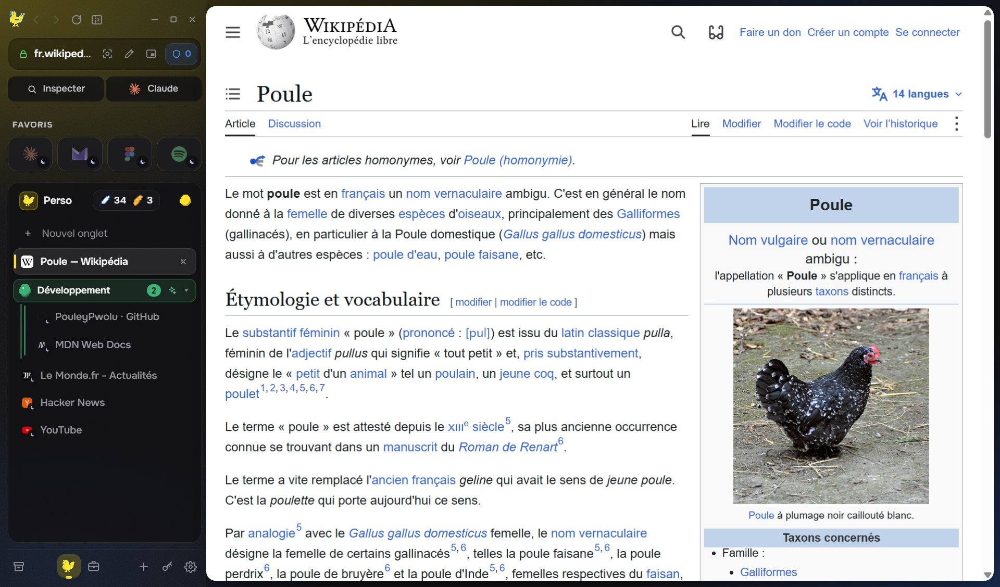
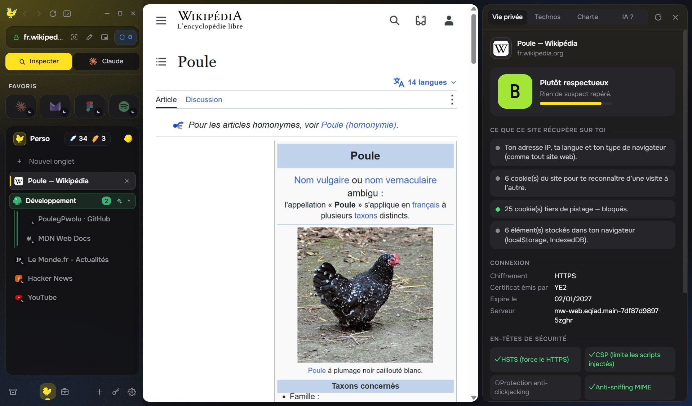
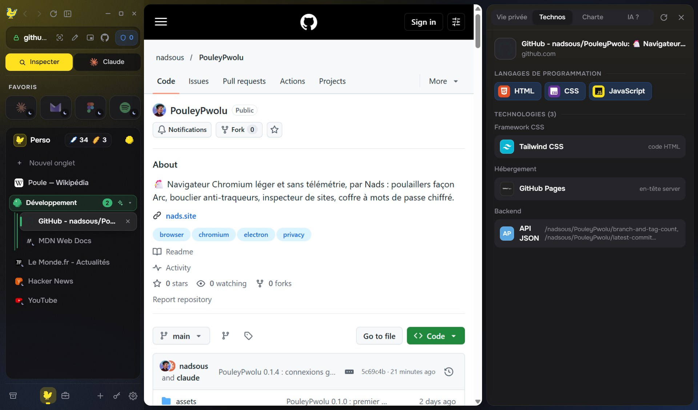
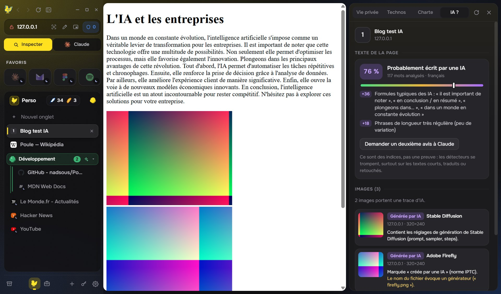
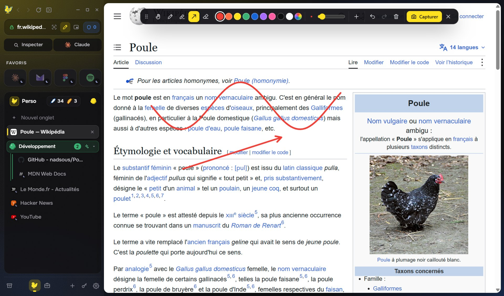
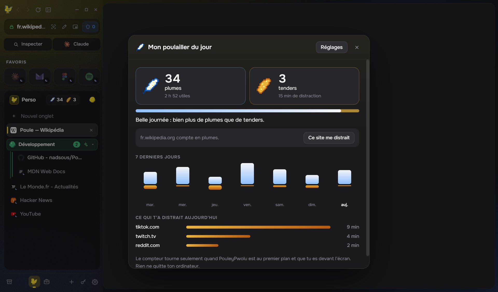
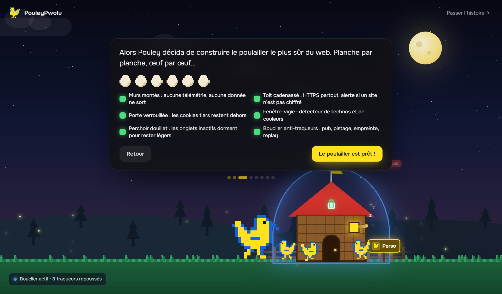

<div align="center">


# PouleyPwolu

**Navigateur web léger et privé pour Windows, basé sur Chromium.**<br>
Zéro télémétrie, bloqueur de traqueurs, poulaillers façon Arc, détecteur d'IA, coffre à mots de passe chiffré.

[](https://github.com/nadsous/PouleyPwolu/releases/latest)
[](https://github.com/nadsous/PouleyPwolu/releases)
[](https://github.com/nadsous/PouleyPwolu/releases/latest)
[](#mises-à-jour)
[](legal/LICENSE.txt)

### [⬇ Télécharger PouleyPwolu pour Windows](https://github.com/nadsous/PouleyPwolu/releases/latest)



</div>

## Pourquoi PouleyPwolu ?

- 🛡️ **Ta vie privée d'abord** : aucune donnée collectée, aucun compte, aucune statistique. Environ 200 traqueurs bloqués, cookies tiers refusés, HTTPS partout, alertes quand un site prend ton empreinte.
- 🐔 **Les poulaillers**, comme les Spaces d'Arc : un pour le perso, un pour le travail, chacun avec sa couleur. Une seule connexion (Proton, Google…) partagée entre tous, ou isolée si tu préfères.
- 🔍 **Un inspecteur de sites** : ce que la page récupère sur toi (note de A à F), ses technos avec leur logo, sa charte graphique.
- 🤖 **Un détecteur d'IA** : repère les images générées par IA (C2PA, IPTC, Stable Diffusion, Midjourney…) et les textes qui sentent ChatGPT, sans rien envoyer sur Internet.
- 🔐 **Un coffre à mots de passe chiffré**, avec Windows Hello. Les extensions du Chrome Web Store fonctionnent (Proton Pass, Bitwarden, uBlock Origin Lite…).
- ✏️ **Un stylo** pour écrire sur n'importe quelle page, puis capturer l'écran.
- 🍗 **Plumes et tenders** : un compteur de productivité. Moins de tenders (TikTok, Twitch…), plus de plumes.
- 🪶 **Léger** : les onglets inutilisés s'endorment, l'interface est en JavaScript natif, sans framework.

## Captures d'écran

<table>
<tr>
<td width="50%"><br><b>Inspecteur, vie privée</b> : ce que le site récupère sur toi, expliqué simplement.</td>
<td width="50%"><br><b>Inspecteur, technos</b> : langages, frameworks et hébergeur, avec leur logo.</td>
</tr>
<tr>
<td><br><b>Détecteur d'IA</b> : score du texte et signatures des images (page de démonstration).</td>
<td><br><b>Stylo</b> : écrire sur toute la page, Mes stylos, capture visible ou page entière.</td>
</tr>
<tr>
<td><br><b>Plumes et tenders</b> : ta journée, ta semaine, ce qui t'a distrait.</td>
<td><br><b>L'installation</b> : l'histoire de Pouley contre le Renard des Traqueurs.</td>
</tr>
</table>

## In English

**PouleyPwolu is a lightweight, privacy-first web browser for Windows, built on Chromium (Electron).** No telemetry, no account, no tracking. It blocks about 200 trackers and third-party cookies, forces HTTPS, and warns you when a site fingerprints you. It brings **Arc-style spaces** ("poulaillers"), a **site inspector** (privacy grade, tech stack detection like Wappalyzer, color palette), a local **AI content detector** for images (C2PA, IPTC, Stable Diffusion metadata) and text, an encrypted **password manager** with Windows Hello, **Chrome Web Store extensions** support, a **pen tool** to annotate any page and take screenshots, and a playful **productivity counter**. The interface is in French. Free to use (proprietary freeware).

## Licence

Logiciel propriétaire gratuit : voir [`legal/LICENSE.txt`](legal/LICENSE.txt) et la section [Distribuer PouleyPwolu](#distribuer-pouleypwolu).

## Lancer depuis le code


```bash
npm install
npm start            # lance le navigateur
npm run dist         # construit l'installateur Windows (release/)
```

> Si `ELECTRON_RUN_AS_NODE=1` est défini dans ton terminal (certains outils le font), Electron démarre comme Node et plante sur `app.commandLine`. Retire la variable avant de lancer : `env -u ELECTRON_RUN_AS_NODE npm start`.

Pour tester sans toucher à ton profil : `POULEY_PROFILE=C:\chemin\profil-test npm start`.

## Ce qu'il fait

| | |
|---|---|
| **Vie privée** | Zéro télémétrie, zéro compte, pas de rapport de plantage, pas d'historique. Les réglages et les onglets restent sur l’ordinateur, chiffrés (voir « Chiffrement »). Les services réseau en arrière-plan de Chromium sont coupés (traduction, Privacy Sandbox, correcteur orthographique qui télécharge chez Google…). |
| **Chiffrement** | Onglets, favoris, poulaillers, archive et réglages : `pouley-state.enc`, chiffré en AES-256-GCM avec une clé aléatoire protégée par Windows (DPAPI) : illisible depuis un autre compte ou un autre ordinateur. Cookies chiffrés par Chromium (fuse `EnableCookieEncryption`). Cache des pages effacé à la fermeture et au démarrage. Paramètres → Données indique aussi si BitLocker chiffre le disque. La version installée ignore `ELECTRON_RUN_AS_NODE`, `NODE_OPTIONS` et `--inspect`, pour qu’aucun programme ne puisse s’en servir pour lire tes données. |
| **Coffre à mots de passe** | Mot de passe maître passé par scrypt (128 Mo par essai), identifiants chiffrés en AES-256-GCM dans `pouley-coffre.enc`. Déverrouillage par Windows Hello en option. Verrouillage après 15 min sans utilisation, au verrouillage de Windows et à la mise en veille. Bandeau « Ranger le mot de passe ? » après une connexion, petite clé dans les champs pour remplir en un clic : une page ne reçoit que les identifiants de son propre site. Générateur, alerte sur les mots de passe faibles ou réutilisés, import du CSV exporté par Chrome, Comet, Edge, Opera ou Brave (le fichier est ensuite écrasé). |
| **Connexion Google** | Google bloque les navigateurs construits sur Electron (« Ce navigateur ou cette application ne sont peut-être pas sécurisés »). Sur `accounts.google.com` seulement, PouleyPwolu se présente comme Google Chrome, dont il partage le moteur : marque « Google Chrome » dans les en-têtes et les Client Hints (réglée via le protocole DevTools, invisible pour la page) et objets `chrome.app`, `chrome.csi`, `chrome.loadTimes`. Les autres sites voient le PouleyPwolu habituel. |
| **Bouclier** | Bloque environ 200 domaines traqueurs en 5 catégories (publicité, mesure d'audience, réseaux sociaux, empreinte, enregistrement de session). Niveaux : strict, standard ou désactivé. Bloque aussi les cookies tiers, réduit le référent à l'origine, envoie `Sec-GPC: 1` et `DNT: 1`, empêche WebRTC de révéler l'IP locale, passe tout en HTTPS (avec un avertissement si le site ne le propose pas) et refuse les certificats invalides. |
| **Alertes** | Une notification « Pouley te prévient » apparaît quand un site lit ton canvas, demande ta carte graphique (WebGL), calcule une empreinte audio, liste tes polices, tente d'enregistrer ta session ou charge une page en HTTP. |
| **Inspecteur** (`Ctrl+I`) | **Vie privée** : note de A à F, ce que le site récupère sur toi expliqué simplement, certificat, en-têtes de sécurité, traqueurs bloqués, domaines tiers, cookies. **Technos** : environ 120 signatures façon Wappalyzer (WordPress, Next.js, React, Shopify, Laravel, Cloudflare…) avec leur version, leur **logo officiel** et les **langages de programmation**. **Charte** : palette pondérée par surface, rôle de chaque couleur, typographies, variables CSS, export CSS ou JSON. |
| **Poulaillers** | Les Spaces d'Arc. Chaque poulailler a son icône et sa couleur. Les connexions (Proton, Google…) sont partagées entre tous par défaut ; un poulailler peut aussi avoir ses propres cookies (deux comptes Google côte à côte). On passe de l'un à l'autre avec `Ctrl+1…9`, `Ctrl+Alt+↑/↓` ou un glissement à deux doigts sur la barre. |
| **Comme Arc** | Favoris en grille, onglets épinglés, palette de commandes (`Ctrl+T` / `Ctrl+L`), glisser-déposer, archivage automatique des vieux onglets, onglets éphémères (`Ctrl+Maj+N`). |
| **Groupes d'œufs** | Onglets réunis côte à côte sous un œuf coloré (repliables, renommables, 9 couleurs). Rangement automatique par thème (Développement, IA, Vidéos, Réseaux sociaux, Achats, Docs, Actus, Musique, Mails) ou par site ; un lien ouvert depuis un groupe y reste. Bouton « Ranger » à côté du nom du poulailler, clic droit sur un onglet → « Groupe d'œufs ». |
| **Barre** | À gauche, à droite ou en haut, avec masquage automatique possible (`Ctrl+S`). |
| **IA** | Claude, ChatGPT ou Comet (choisi pendant l'installation), dans un panneau latéral (`Ctrl+E`). Tape `?question` dans la palette, ou `Maj+Entrée`. Clic droit → « Demander à… » / « Résumer la page ». |
| **Comet** | Moteur de recherche « Comet (Perplexity) ». Si Comet est installé, clic droit → « Ouvrir dans Comet ». |
| **Légèreté** | Interface en JS natif, sans framework ni dépendance d'exécution. Les onglets inactifs se mettent en veille (15 min par défaut) et ne sont restaurés qu'au clic. Les connexions survivent à la veille et à un redémarrage : le `sessionStorage` de chaque onglet est gardé chiffré (`pouley-session.enc`, lu puis effacé au lancement) et rendu au même site, dans le même poulailler. La liste d'onglets n'est redessinée que si quelque chose a changé, et les onglets glissent à leur place. |
| **Détecteur d'IA** | Onglet « IA ? » de l'inspecteur, ou clic droit sur une image ou un texte sélectionné. Images : Content Credentials C2PA, champ IPTC « trainedAlgorithmicMedia », réglages Stable Diffusion et ComfyUI, nom de l'outil (Midjourney, DALL·E, Firefly, Flux…) dans les métadonnées, adresse d'un service de génération. Textes : score avec indices expliqués (formules typiques, régularité des phrases, restes de Markdown, caractères invisibles). Tout est analysé sur la machine (`src/main/ai-detect.js`). |
| **Stylo** (`Ctrl+Maj+D`) | Écrire et dessiner sur toute la page : stylo (sensible à la pression d'un stylet), surligneur, flèche, gomme, 9 couleurs et une roue, épaisseur, annuler / rétablir. « Mes stylos » garde jusqu'à 6 réglages favoris. Capture de la zone visible ou de la page entière, dessin compris. Le calque vit dans une ombre fermée : la page ne peut pas le lire. |
| **Plumes et tenders** | Compteur de productivité, à côté du nom du poulailler : 5 minutes sur un site qui distrait (TikTok, Twitch, Reddit…, liste modifiable) = un tender, 5 minutes actives ailleurs = une plume. Panneau du jour, 7 derniers jours, petit mot de Pouley tous les 3 tenders. Ne compte que fenêtre au premier plan et utilisateur présent ; gardé chiffré 14 jours. |
| **Installation animée** | Au premier lancement, l'histoire de Pouley face au Renard des Traqueurs : la nuit tourne à l'aube, le poulailler se construit étape par étape puis vit (poules, traqueurs qui rebondissent sur le bouclier). Les choix (IA, moteur, position de la barre, premier poulailler) se font dans le récit. Pour la revoir : palette → « Revoir l'histoire de Pouley ». |
| **Extensions Chrome** | Installe les extensions du Chrome Web Store (Proton Pass, Bitwarden, uBlock Origin Lite, Dark Reader…) : colle leur lien dans Paramètres → Extensions, ou ouvre leur page du store et clique « Ajouter à PouleyPwolu ». La signature CRX3 du développeur est vérifiée (l’identifiant de l’extension est l’empreinte de sa clé), les permissions sont expliquées avant l’installation, et leur bouton apparaît à côté d’« Inspecter ». Electron ne fournit qu’une partie des API de Chrome : `src/preload/ext-compat.js` ajoute celles qui manquent (onglets, fenêtres, permissions, menus, notifications, navigation) et `src/main/ext-host.js` les relie aux vrais onglets. Mises à jour vérifiées une fois par jour auprès de Google, seulement si une extension du store est installée. |
| **Extensions** | **NadsPDF** (extension Chrome, préinstallée) : les PDF du web s'ouvrent dans l'éditeur NadsPDF (lire, annoter, remplir, signer), sans rien envoyer sur Internet. Ses règles de redirection sont reproduites par le navigateur, car Electron ne gère pas `declarativeNetRequest`. Activable dans Paramètres → Extensions. Copiée depuis `../nadspdf/dist/chrome-extension` par `npm run sync-extensions` (lancé aussi par `npm run dist`). |
| **Jeu hors ligne** | *Pouley contre le Renard* : sans réseau, ou via `pouley://jeu`. Picore le maïs, prends les œufs d'or (ils font fuir les renards), sprinte avec `Espace`. Un renard de plus arrive toutes les 25 s. |

## Raccourcis

`Ctrl+T` palette · `Ctrl+L` modifier l'adresse · `Ctrl+W` fermer · `Ctrl+Maj+T` rouvrir · `Ctrl+D` épingler · `Ctrl+I` inspecteur · `Ctrl+E` IA · `Ctrl+F` rechercher dans la page · `Ctrl+S` barre · `Ctrl+1…9` poulaillers · `Ctrl+Tab` onglet suivant · `Ctrl+Maj+C` copier l'URL · `Ctrl+Maj+D` stylo · `Ctrl+Maj+S` capture · `Ctrl+,` paramètres · `F12` outils dev

## Structure

```
src/main/       processus principal : onglets, bouclier, inspecteur, poulaillers, détecteur d'IA, compteur
src/preload/    ponts sécurisés (interface, sondes d'empreinte dans les pages)
src/renderer/   interface : barre, palette, réglages, inspecteur, histoire
src/pages/      pages internes pouley:// (nouvel onglet, erreurs, jeu)
src/shared/     sprites pixel-art et configuration partagés
scripts/        génération des icônes et des images de l'installateur, publication
docs/captures/  captures d'écran du README
```

## Crédits

Logos des technologies et des moteurs de recherche : [Simple Icons](https://simpleicons.org) (CC0 1.0). Logos des assistants IA : [LobeHub Icons](https://github.com/lobehub/lobe-icons) (MIT). Tous embarqués hors ligne (`npm run tech-icons`, `npm run brand-logos`). Les marques appartiennent à leurs détenteurs.

## Distribuer PouleyPwolu

PouleyPwolu est un **logiciel propriétaire gratuit** : chacun peut l'installer et l'utiliser, et partager l'installateur officiel non modifié. Il est interdit de le revendre, de le modifier ou d'en retirer le nom et la marque Nads. Le contrat complet est dans `legal/LICENSE.txt`. Il s'affiche dans l'installateur et doit être accepté. On le retrouve aussi dans Paramètres → À propos. Les licences des composants tiers sont dans `legal/THIRD_PARTY_NOTICES.txt`.

### Installer (à donner à tes utilisateurs)

L'installateur n'est pas encore signé numériquement. Au premier lancement, Windows affiche **« Windows a protégé votre ordinateur »** :

1. cliquer sur **Informations complémentaires** ;
2. vérifier que l'éditeur affiché est « Éditeur inconnu » et le fichier `PouleyPwolu-Setup-x.y.z.exe` ;
3. cliquer sur **Exécuter quand même**, puis accepter la licence.

Pour vérifier que le fichier n'a pas été modifié, comparer son empreinte (PowerShell : `Get-FileHash PouleyPwolu-Setup-x.y.z.exe`) avec celle publiée dans la note de chaque release GitHub. Pour supprimer l'alerte de Windows, il faudra signer l'installateur (Microsoft Store gratuit, ou Azure Trusted Signing à environ 10 $/mois).

## Mises à jour

### 1. Mettre Chromium à jour

Chromium est fourni par Electron : mettre Electron à jour, c'est mettre Chromium à jour, avec ses correctifs de sécurité.

```
npm run update-chromium              # dernière version de la même version majeure (sûr)
npm run update-chromium -- --major   # passer à la version majeure suivante (à tester davantage)
npm start                            # vérifier que tout marche
```

Electron publie une version majeure toutes les 8 semaines et des correctifs de sécurité chaque semaine environ. Lance `npm run update-chromium` au moins une fois par mois.

### 2. Envoyer la mise à jour à tous les utilisateurs

```
npm run release            # 0.1.0 → 0.1.1 (correctif)
npm run release -- minor   # 0.1.1 → 0.2.0 (nouveautés)
```

Le script augmente le numéro de version, construit l'installateur et crée la release `vX.Y.Z` sur [GitHub](https://github.com/nadsous/PouleyPwolu/releases) avec ses 3 fichiers :

- `PouleyPwolu-Setup-x.y.z.exe` : l'installateur ;
- `PouleyPwolu-Setup-x.y.z.exe.blockmap` : permet de ne télécharger que les morceaux modifiés ;
- `latest.yml` : annonce la nouvelle version et son empreinte SHA-512.

Il faut la commande `gh` connectée au compte `nadsous` (`gh auth login`). Pense à pousser le code avant (`git push`).

Chaque PouleyPwolu installé vérifie 10 s après le lancement, puis toutes les 6 h. Il télécharge la mise à jour en arrière-plan, contrôle son empreinte, puis affiche « Redémarrer ». Sinon, elle s'installe toute seule à la fermeture.

Vie privée : c'est la seule connexion que PouleyPwolu fait de lui-même (vers github.com). Elle ne contient aucun identifiant, seulement la lecture de `latest.yml`. On peut la couper dans Paramètres → À propos.

La mise à jour automatique ne fonctionne qu'à partir de la première version installée qui la contient : les personnes qui ont l'ancien installateur 0.1.0 doivent installer une fois la nouvelle version à la main.
